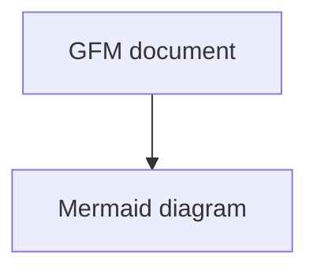

# GitHub Flavored Markdown

| Feature | Status |
| :--- | ---: |
| Tables | Supported |
| Escaped pipe | a\|b |

- [ ] Pending task
- [x] Completed task
- [X] Uppercase completed task

~~Obsolete~~ and **current**.

https://github.com and <https://example.com> and test@example.com.

"Literal quotes" -- three dots... and (c).

```javascript
const literal = "~~not struck~~";
```

`~~inline literal~~`

> A quoted paragraph.

<details>
<summary>More information</summary>

Expanded **details**.

</details>


