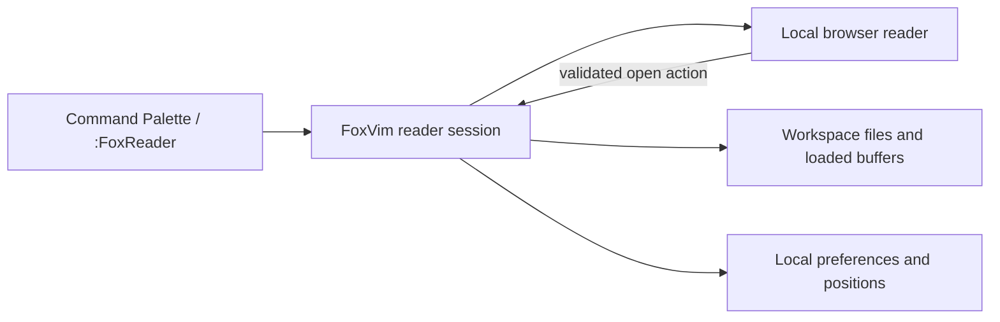

# Fox Reader: technical design

## Verified context

- `lua/fox/markdown/browser.lua` launches browsers across supported platforms and installs preview lifecycle hooks. `server.lua` is a loopback HTTP server with a random URL prefix, Host validation, a content security policy, buffer-based pages and cursor-following updates.
- `lua/plugins/editor/markdown.lua` lazily registers preview commands; `lua/plugins/fox/tools/command_palette.lua` registers the existing palette action. `tools/fox-markdown-gh/` contains assets for the separate GitHub-style Markdown preview, which is outside Fox Reader's scope.
- The user chose a FoxVim-native reader instead of adapting Folio. The existing reader uses the local Markdown renderer and Mermaid bundle; further rendering dependencies must include their required notices.

## Decisions and proposed boundaries

1. Preserve the existing preview. Reuse its browser launcher and proven transport protections where suitable; inspect coupling before deciding whether a reader-specific server or a shared transport is smaller and safe. Do not attach reader lifetime to a preview buffer.
2. Register `:FoxReader` for lazy loading from any buffer and add a descriptive command palette entry. Capture the effective cwd at invocation. Each open reader session stays associated with its original root and Neovim process. Automatically use the OS default browser and focus an existing relevant reader tab on repeated opens. Investigate browser and OS capabilities early: ordinary browser launches may not reliably focus an existing tab, so validate a workable approach on Windows and other supported platforms before committing to an implementation; do not claim tab focus works without verification.
3. Serve a locally bundled frontend and only the dependencies required for offline reading. Pin dependency versions, retain required notices, and record reproducible build steps where applicable.
4. Implement the HTTP service in Lua using Neovim APIs, without Node.js, Python or Go runtime dependencies. Use a workspace-scoped document interface: enumerate the whole cwd tree with bounded or incremental work, filtering against an editable extension array near the top of the feature's Lua configuration, initially `{ ".md", ".txt" }`. Resolve relative Markdown links and supported local assets relative to the document, and prefer a loaded buffer over the on-disk file. Use stable validated root-relative document identities, not arbitrary editor commands from the browser.
5. Retain a loopback-only listener, unpredictable session capability, Host validation, restrictive CSP and bounded requests. Validate write-like actions separately, including origin and capability checks; avoid permissive CORS. Resolve canonical paths and enforce directory-boundary checks after decoding, including symlinks and Windows path/case behavior. Revalidate before reads or editor opens to reduce path-swap risks.
6. Persist preferences globally and positions keyed by normalized workspace and document identity in `stdpath('state')` or an existing equivalent. Use a structural anchor (for example heading/source position plus offset) with a fallback when content changes. Do not depend on port-scoped browser storage. Handle corrupt or unwritable state gracefully.
7. Refresh changed loaded buffers and disk files without applying cursor-follow events; preserve a semantic reading anchor across rerenders. Choose polling or another existing mechanism after source inspection, with bounded work and cleanup on exit.

## Expected integration points

- `lua/fox/markdown/`: reader session, transport and workspace logic as needed; share only code that fits both lifecycles.
- `lua/plugins/editor/markdown.lua` and `lua/plugins/fox/tools/command_palette.lua`: lazy command and palette registration.
- `tools/fox-reader/`: permitted static frontend build assets, local runtime dependencies and required notices.
- `tests/` and `docs/editor-qol.md`: meaningful unit/integration coverage and user-facing workflow.

A document identity comprises the captured canonical workspace root and a validated root-relative path; state must never be treated as authority to bypass path checks.

## Risks and unresolved details

- Third-party asset terms and notices must be checked before adding dependencies.
- Rendering untrusted Markdown, local images and browser-to-editor actions creates security boundaries; test traversal, symlinks, origin/capability checks and hostile content, including Windows-specific paths.
- Large repositories, changed files, lost anchors, symlink races and concurrent reader sessions need explicit behavior and tests. Define bounded scanning and repeated-open behavior without silently omitting workspace directories or broadening access.
- Focusing an existing default-browser tab is OS- and browser-dependent; validate feasibility early and report any platform limitation rather than silently opening duplicate tabs.
- Bookmarks are deferred until the core reader works.
